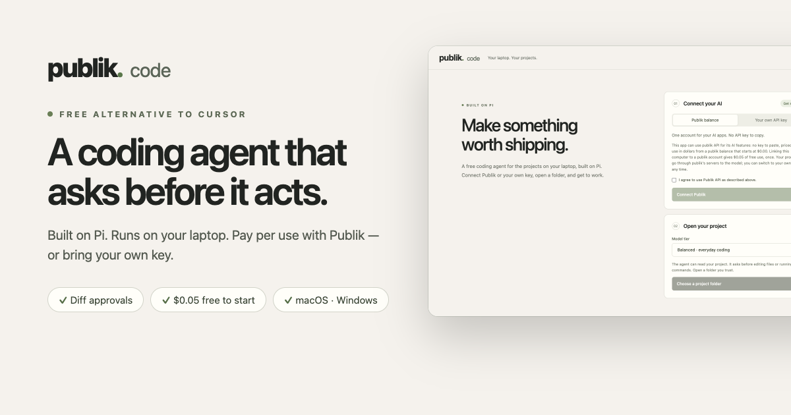
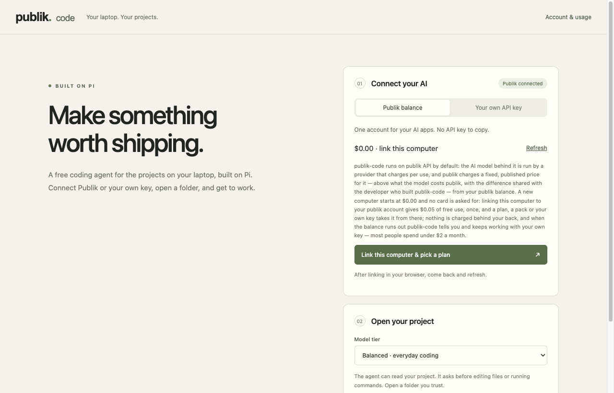
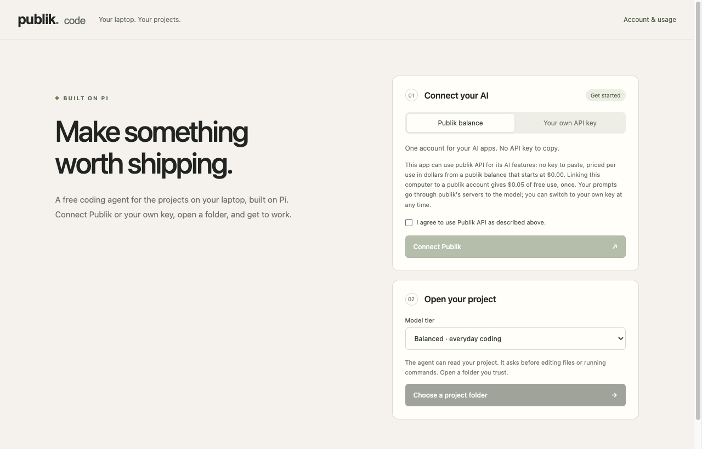
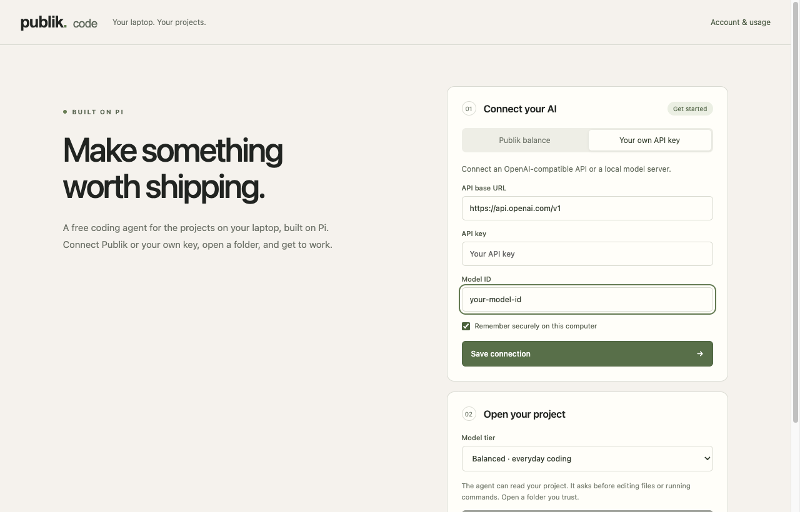

<p align="center">
  
</p>

<p align="center">
  <strong>A free, open-source coding agent for the projects on your laptop.</strong><br>
  Built on <a href="https://github.com/earendil-works/pi">Pi</a>. Every edit and command waits for your OK. Pay per use with Publik, or bring your own key.
</p>

<p align="center">
  <a href="https://publikhq.com/publik-code"></a>
  <a href="#install"></a>
  <a href="LICENSE"></a>
</p>

<p align="center">
  <a href="#install"><strong>Install</strong></a> ·
  <a href="#how-it-compares"><strong>Compare</strong></a> ·
  <a href="CHANGELOG.md"><strong>Changelog</strong></a> ·
  <a href="docs/DEVELOPMENT.md"><strong>Developer guide</strong></a> ·
  <a href="https://publikhq.com/publik-code"><strong>Publik listing ↗</strong></a>
</p>

## What it does

Open a folder, say what you want changed, and watch the agent work. It reads your code freely, then shows you **a diff before every edit** and **the exact command before every shell call**. Allow or decline, one step at a time, or allow a tool for the rest of the session.

- **No key to paste.** Publik Code runs on [Publik](https://publikhq.com) by default: `publik-balanced` for everyday coding, `publik-fast` for quick jobs, `publik-smart` for hard ones. Link this computer once for $0.05 of free use; after that you pay per call from your Publik balance. The workspace shows your balance as you go.
- **Or bring your own.** Any OpenAI-compatible endpoint works: OpenAI, OpenRouter, a local server like Ollama or LM Studio. Keys are stored with your OS's encryption, or kept for the session only.
- **A real agent loop.** The engine is [Pi](https://github.com/earendil-works/pi): read / edit / write / bash tools, persistent sessions per folder, and automatic context compaction for long tasks.
- **Runs on your laptop.** Your files stay where they are. Prompts and the code the agent reads go to the model provider you chose.

<p align="center">
  
</p>

<details>
<summary><strong>More screenshots</strong></summary>
<br>

| First run | Bring your own key |
|:---:|:---:|
|  |  |

</details>

## Install

**Download** the latest build from [Releases](https://github.com/VedSoni-dev/publikhqapicodingagent/releases) or from the [Publik listing](https://publikhq.com/publik-code):

| Platform | File | Notes |
|:---|:---|:---|
| macOS · Apple Silicon | `Publik-Code-<version>-mac-arm64.dmg` | Unsigned: the first time, right-click the app → **Open** → **Open**. |
| Windows · x64 | `Publik-Code-<version>-windows-x64.exe` | Unsigned: SmartScreen may say "Windows protected your PC" → **More info** → **Run anyway**. Install [Git for Windows](https://git-scm.com/download/win) so the agent can run shell commands. |

Then:

1. **Connect your AI.** Read the one-paragraph disclosure and click **Connect Publik**, or open **Your own API key**.
2. **Link this computer** (Publik only) in your browser for $0.05 of free use, then come back and hit **Refresh**.
3. **Open a project folder** you trust and ask for a change.

**From source** (Node.js 22.19+, Git): `git clone`, `npm ci`, `npm start`. Source checkouts don't carry the Publik app token, so use your own key there. Details in the [developer guide](docs/DEVELOPMENT.md).

## How it compares

A fair, feature-by-feature look. Cursor and Claude Code are excellent products with far more features. Publik Code is for people who want a small, open, pay-per-use agent with an approval step on every change.

| | **Publik Code** | **Cursor** | **Claude Code** |
|:---|:---|:---|:---|
| What it is | Desktop agent app (chat + approvals) | AI code editor (VS Code fork) | Agent in the terminal, IDE extensions, desktop and web |
| Code editor, tab autocomplete | ✗ (use your own editor alongside) | ✓ | ✗ editor; works with yours |
| Agent edits files and runs commands | ✓ | ✓ | ✓ |
| Approval before every edit and command | ✓ always on; per-tool "allow for session" | Configurable | Configurable permission modes |
| Diff shown before applying an edit | ✓ | ✓ | ✓ |
| Models | Publik tiers, or any OpenAI-compatible API / local model | Many hosted models, BYO key for some | Claude models |
| Pricing | App is free; pay per use from a Publik balance ($0.05 free on first link), or your own provider's rates | Free tier with limits; paid subscriptions | Claude subscription or API usage |
| Sessions persist per project | ✓ | ✓ | ✓ |
| Long-task context compaction | ✓ (Pi) | ✓ | ✓ |
| MCP servers, plugins, hooks | ✗ not yet | ✓ | ✓ |
| Background / cloud agents | ✗ | ✓ | ✓ |
| Open source | ✓ MIT | ✗ | ✗ |
| Platforms | macOS (Apple Silicon), Windows x64 | macOS, Windows, Linux | macOS, Windows, Linux |

> **Tool approvals are not a sandbox.** When you allow a command, it runs with your user account's full permissions. Files, comments and command output in a project can steer the model (prompt injection). Open projects you trust, read commands before you allow them, and use a VM or container for untrusted code.

## Publik API

Publik Code is wired to the [Publik API](https://publikhq.com/skills/api.md) (`https://publikhq.com/api/v1`, OpenAI-compatible):

- On first connect the app provisions its own per-install key (`POST /installs`) and stores it in Publik's per-app credential file (mode 0600). No key is ever shown or logged.
- Requests go through a local loopback gateway, so the coding engine never sees your Publik or own key.
- Only Publik tiers are sent (`publik-fast`, `publik-balanced`, `publik-smart`). `x-publik-*` headers keep the balance current.
- An empty balance (HTTP 402) shows Publik's message and one top-up link; your own key keeps working.
- Release builds pass Publik's built-app check: `PUBLIK_SELF_TEST=1 "Publik Code.app/Contents/MacOS/Publik Code"` → `publik self-test: ok publik-code 0.1.0`.

## Privacy

Everything runs locally except model calls. Sessions are stored in the app's data folder on your computer. Publik [says](https://publikhq.com/developers) it does not train on requests and keeps no bodies beyond a 24-hour idempotency fingerprint (provider abuse retention still applies). With your own key, your provider's terms apply.

## For builders

```sh
npm ci
npm run typecheck
npm test             # Publik module, gateway, and the Pi engine against a scripted local model
npm run test:desktop # Electron end-to-end: connect, approve an edit, decline a command
npm run package:mac  # or package:win
```

Architecture, credential handling, and packaging: [docs/DEVELOPMENT.md](docs/DEVELOPMENT.md). What's been verified: [VALIDATION.md](VALIDATION.md). Listing media is captured from the real app with `scripts/capture-media.ts`.

## Credits

[MIT licensed](LICENSE). **Built on [Pi](https://github.com/earendil-works/pi)** by Mario Zechner and contributors (MIT); Publik Code is an independent project, not Pi itself, and isn't affiliated with or endorsed by the Pi project, Cursor, or Anthropic. Earlier development builds used [OpenCode](https://github.com/anomalyco/opencode). [Third-party notices](THIRD_PARTY_NOTICES.md) · [Brand asset sources](docs/branding/README.md).
